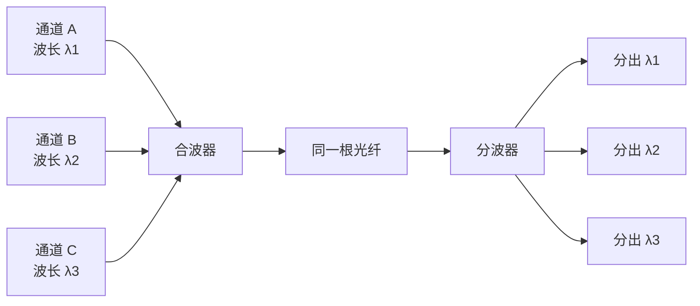
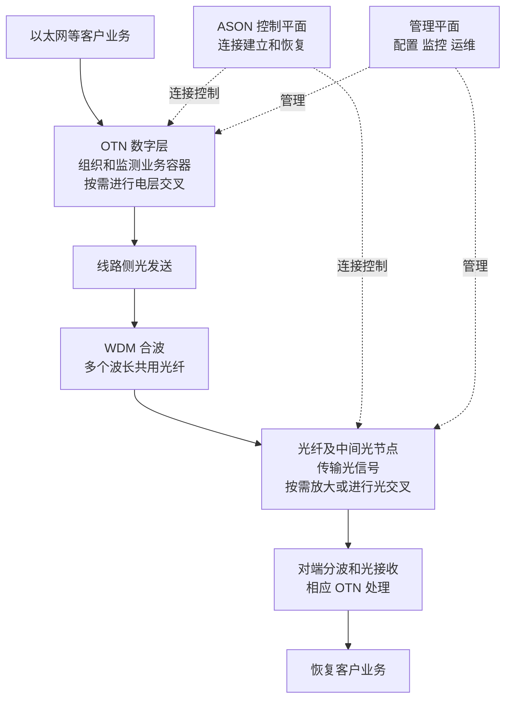

# 光网络基础知识通俗讲义

两台设备相隔几十公里，数据怎样从一端到另一端？业务越来越多，一根光纤为什么还能继续扩容？光纤没有断，业务为什么仍然可能出问题？这篇讲义围绕这些问题，介绍光网络的基本组成和工作方式。

先记住一句话：**光网络要把信息变成光信号，沿合适的通路送到对端，并让对端能够正确还原信息。**围绕这件事，才有了光模块、波分、OTN、光放大器和光交叉等技术。

本篇依据联通课程《光网络基础知识》的摘要、带时间点的大纲及部分原课画面整理，是重新组织的入门讲解，不是视频逐字稿。每节附原课回查时间；标为“补充例子”“补充解释”的内容用于帮助理解，不代表老师的原话或现网配置。原课发布于 2022 年，本文主要讲基本原理，不把课程中的历史速率和产业判断当作当前现状。

第一次按第 1 至第 7 节阅读，再做第 9 节自测；第 8 节的相干通信可以留到第二遍。遇到缩写时，先理解它解决的问题，不必急着记住英文全称。

## 1 从你熟悉的交换机和路由器说起

**原课回查：01:02 至 02:23，40:14 至 41:02。**

你已经接触过交换机、VLAN、IP 地址和路由。这些知识关注的是：一份数据属于哪个网络，应该转给谁，通过哪个端口出去。

但端口选好了，数据还要跨过真实的距离。两栋楼之间、两个城市之间，需要把信号可靠地送过去。光网络解决的就是这类传送问题。

### 一条最简单的光链路


这是一个方向的简化示意。双向通信还需要反方向的通路，可以采用不同的光纤或不同波长等安排，取决于设备和方案。

**补充例子：**A 机房的路由器要向 B 机房发送数据。距离、速率和接口条件合适时，两端插上匹配的光模块，用光纤连接就能工作。如果距离更长、业务更多、需要跨多个节点调度，就可能需要专门的传送设备、波分系统和放大节点。

所以，看到一条光纤，不能直接断定它承载的是哪一种业务；看到一个光模块，也不能直接断定中间一定经过 OTN。

### 数据层和传送层可以分别理解

| 观察角度 | 主要关心什么 | 常见对象 |
| --- | --- | --- |
| 以太网和 IP 网络 | 数据应该转给谁，经过哪些逻辑节点 | 交换机、路由器、MAC、IP、路由表 |
| 光传送网络 | 业务如何跨距离传送，怎样复用、调度和监测 | OTN 设备、波长通道、光放大器、光路 |
| 物理设施 | 信号实际经过哪里 | 光纤、光缆、接头、管道 |

这几个角度互相联系。一条 IP 链路背后，可能对应一条经过多个光传送节点的通路。

**这一节要会说清：路由器选择数据的去向，光传送系统提供承载通路；实际设备可以集成多种功能。**

## 2 光纤 光缆 光模块分别是什么

**原课回查：08:28 至 11:53，16:31，23:21 至 26:30。**

### 光纤负责导光 光缆负责保护和铺设

光纤是一条很细的导光介质，通常由纤芯和包层等组成。纤芯与包层的折射率配合，使光能够沿光纤传播。入门时，可以把它理解成一条经过精心设计的“光的通道”。

光缆则是在一根或多根光纤外增加保护、加强和适应敷设环境的结构。地下铺设或架空敷设时，使用的是光缆，不是把裸露的纤芯直接放出去。

| 名称 | 通俗理解 | 容易混淆的地方 |
| --- | --- | --- |
| 光纤 | 实际导光的细通道 | 一根光纤可以承载多个波长 |
| 光缆 | 包含光纤及保护结构的线缆 | 一根光缆里可以有很多根光纤 |
| 光模块 | 装在设备端口上的光电接口部件 | 不是光纤，也不等于一套完整光传送网络 |
| 光发射机和接收机 | 分别负责发送和接收光信号的功能单元 | 常见收发一体光模块同时包含两类功能 |

单模光纤和多模光纤中的“模”，描述的是光在光纤中的传播模式。**单模不等于只能传一个波长，也不等于只能承载一条业务。**

### 数据怎样放到光上

设备处理的数据可以表示为 0 和 1。发送端利用光源，并通过调制，让光的某些特征随着数据发生变化。

**补充解释：**最容易想象的是“用较亮和较暗表示不同状态”。这是理解强度调制的一种入门模型。真实系统还可以使用多个强度等级，或利用相位、偏振等特征传递信息，不能把所有光通信都理解为手电筒简单地亮一下、灭一下。

接收端用光电探测器把接收到的光转换为电信号，再经过相应处理恢复数据。课程提到的 PIN、APD 是两类光电探测器；第一遍知道它们负责“把光变成可处理的电信号”就够了。

### 看光模块不能只看外形

**补充解释：**端口能插进去，不代表两端就能通信。还要核对速率、接口规范、工作波长、光纤类型、发送和接收的光功率范围等条件。标称传输距离也有对应的光纤和链路条件，不能只按两地直线距离选模块。

## 3 一根光纤怎样同时承载很多信息

**原课回查：28:02 至 30:23。**

“复用”就是让多路信息共用传输资源。先理解两种最常见的思路。

### TDM 按时间轮流使用

TDM 是时分复用。可以把时间切成一小格一小格，让 A、B、C 三路信号依次使用：

```text
时间向右推进 →
| A | B | C | A | B | C | A | B | C |
```

它们共享同一条传输通道，但有各自的时间安排。接收端按相应规则把各路数据分出来。

### WDM 按波长同时使用

WDM 是波分复用，英文为 Wavelength Division Multiplexing。它让不同波长的光信号进入同一根光纤，同时向前传送；到另一端，再把不同波长分开。



**补充比喻：**可以想象成不同“颜色”的光各自携带信息，一起通过同一根管道。不过通信常用的这些波长处于红外范围，肉眼看不见；这里用颜色只是帮助理解。

λ 是波长的常用符号，nm 是纳米。波长不同，表示光波本身的特征不同；它不是 IP 地址，也不是 VLAN 编号。

### 波长数增加 不等于每条业务都自动提速

**补充例子：**假设一条线路有 4 个波长通道，每个通道的标称速率都是 100 Gb/s，那么合计标称容量为：

```text
4 × 100 Gb/s = 400 Gb/s
```

这是这些通道的容量相加。一条被分配到 100 Gb/s 通道内的业务，并不会自动得到 400 Gb/s。实际可用于业务的数据速率，还受封装、纠错、业务映射及其他瓶颈影响。Gb/s 表示每秒十亿比特，注意小写 b 是比特，不是字节。

同一波长内部还可以承载多路业务，所以“一个波长对应一个客户”也不是固定规则。TDM 和 WDM 可以组合使用。

课程还提到 SDM，即空分复用：利用不同空间通道增加并行传送能力，例如多芯或少模光纤中的不同通道。第一遍知道“时间、波长、空间都是分配传输资源的维度”即可。

## 4 SDH OTN ASON各自解决什么问题

**原课回查：04:03 至 06:44，43:41。**

这些缩写不是同一种东西，也不是每出现一种新技术，前一种就立即消失。把它们按“解决什么问题”分开，容易理解得多。

| 技术 | 这一课先抓住的作用 |
| --- | --- |
| SDH 同步数字体系 | 用统一、同步的数字传送结构组织和复用业务 |
| WDM 波分复用 | 让多个波长共享光纤，扩大光纤的承载能力 |
| OTN 光传送网 | 为客户业务提供规范的传送层次、封装、监测和相应调度能力 |
| ASON 自动交换光网络 | 引入控制平面，支持连接的自动建立、调整和恢复 |

### SDH可以先理解为有固定组织规则的传送体系

不同业务不能随意挤进同一条线路。SDH 为数字信号规定了统一的组织方式，通过映射、复用等过程，把业务放进相应传送结构中。它在传统传送网络中发挥过重要作用，课程用它来介绍光网络的发展。

本课先理解“有规则地组织、复用和传送”，暂时不用背帧结构、容器编号和全部速率等级。

### OTN让业务在大容量光网络里可组织 可监测

如果只知道“一根光纤可以传很多波长”，还有几个问题没有解决：不同速率的业务怎么放进去？怎样检查传送是否正常？在中间节点怎样调度业务？

OTN 提供了相关的层次和机制。常见设备可以把以太网等客户信号映射进 OTN 的数字传送结构，在具备相应能力的节点进行电层交叉，再通过线路侧光信号传出去。参见 [Ciena 的 OTN 说明](https://www.ciena.com/insights/what-is/What-is-Optical-Transport-Networking-OTN.html)。

**补充解释：**这里的“客户信号”，指被传送网承载的信号，不只指某家付费客户的业务。“映射”可以先理解为按规定把业务装进相应数字结构；“电层交叉”则是在数字信号层面，把相应业务容器从输入通路接到选定的输出通路。它不等于逐个查看 IP 数据包的目的地址再转发。

**补充比喻：**客户业务像货物，OTN 的数字容器像有统一规格和标记的运输单元，WDM 则让多个光通道同时使用一根光纤。这个比喻只帮助理解分工；并不表示一个数字容器固定对应一个波长。

OTN 也不只是一个“包头”。它涉及多层传送结构、监测和连接关系。更完整的映射和交叉过程，可以留到后面的 OTN 专门课程。以上分工可参照 [ITU 光网络技术综述](https://www.itu.int/dms_pub/itu-t/oth/23/01/T23010000130001PDFE.pdf) 理解。

### ASON关注怎样自动建立连接

前面讲的是信息如何传。ASON 进一步关注：网络能不能按需求自动安排一条通路，故障后能不能重新安排？

它把网络功能分成三个便于理解的角度：

- **传送平面**：实际承载并传送业务。
- **控制平面**：为连接进行路径选择、建立和恢复等控制。
- **管理平面**：进行配置、监控和运维管理。

这不是三张必须各自独立铺设光缆的网络，而是对功能的划分。[ITU-T G.8080 架构说明](https://www.itu.int/rec/dologin_pub.asp?id=T-REC-G.8080-200606-S%21%21PDF-E&lang=f&type=items) 可用于理解这套概念；该链接为历史版本。

原课 06:44 附近的幻灯片写的是 **ASON**。平台自动大纲漏写了 S，不能照抄成 AON。AON 在相应光网络语境中常指全光网络，强调光域传输和交换；ASON 强调自动控制。二者不能互换。

**这一节要会说清：WDM关注多波长共纤，OTN关注业务传送的组织与监测，ASON关注连接控制。它们可以配合工作。**

## 5 光纤没有断 为什么也可能传不好

**原课回查：11:53 至 14:51，26:30。**

判断一条光链路能不能用，不能只问“有没有光”。接收端还必须从收到的信号中正确判断数据。

| 现象 | 可以怎样理解 | 可能影响什么 |
| --- | --- | --- |
| 衰减 | 光信号沿途变弱 | 到达接收端的功率可能不足 |
| 色散 | 信号的不同组成部分传播时延不同，波形发生变化 | 相邻符号可能互相干扰 |
| 噪声 | 有用信号之外混入了干扰成分 | 接收端更难分辨原来的信息 |
| 非线性 | 光纤的响应不再能简单按线性关系描述 | 可能产生额外失真和通道间影响 |

**补充比喻：**衰减像说话声越来越小；色散像原本间隔清楚的声音逐渐拖长、挤在一起；噪声像旁边同时有很多杂音。声音够大，并不代表每个字都听得清。

因此，单纯提高发送功率不能解决所有问题。功率过高还可能超过接收器允许范围，或加重一些非线性影响。

### 光功率的数字怎么看

光功率常用 dBm 表示，它是以 1 mW 为参考的功率单位。**0 dBm 表示 1 mW，不是没有光；负数也不代表故障。**例如 −10 dBm 仍然表示一个非零的光功率。

损耗和增益常用 dB 表示。在一个简化链路预算中，可以这样算：

```text
接收光功率 dBm = 发送光功率 dBm − 总损耗 dB + 总增益 dB
```

**补充算例，以下数字均为教学假设，不是设备推荐配置。**

- 发送光功率为 0 dBm。
- 光纤长 40 km，按每公里损耗 0.25 dB 计算。
- 接头等其他损耗合计 2 dB。
- 沿途没有放大器。

计算得到：

```text
光纤损耗 = 40 × 0.25 = 10 dB
总损耗 = 10 + 2 = 12 dB
接收光功率 = 0 − 12 = −12 dBm
```

再假设接收器在指定工作条件下的灵敏度为 −18 dBm，允许的最大输入功率为 −3 dBm。−12 dBm 位于这两个边界之间，距离灵敏度还有 6 dB 的差值。

这只能说明简化预算中的接收功率满足所设边界。工程上仍要考虑测量误差、老化、额外接头以及色散、噪声等因素，不能据此直接宣布整条业务合格。

### 1310 nm和1550 nm不能按低速 高速简单分家

对常规 **G.652 单模光纤**，零色散波长在 1310 nm 附近；1550 nm 附近通常衰减更低，但并非零色散。系统适合多大速率、传多远，还取决于收发器、调制方式、光纤类型和色散处理等条件。

所以，不要记成“1310 只能低速，1550 只能高速”，也不要记成“所有光纤在 1310 都没有色散”。参见 [ITU-T G.652 光纤特性](https://www.itu.int/epublications/publication/itu-t-g-652-2024-08-characteristics-of-a-single-mode-optical-fibre-and-cable)。

## 6 光放大器能做什么 不能做什么

**原课回查：18:22 至 23:21。**

光信号经过长距离传输会变弱，光放大器可以直接在光域提高信号功率，不必每到一个放大点都先还原成电信号。

课程按放置位置介绍了三类应用：

| 放置位置 | 主要目的 |
| --- | --- |
| 发送侧的功率放大器 | 提高发往线路的光功率 |
| 线路中间的放大器 | 补偿沿途传输损耗 |
| 接收前的前置放大器 | 提高进入后续接收部分的信号功率 |

这些名称主要描述应用位置和用途。EDFA、拉曼放大器则描述不同的放大原理，不要把两种分类混成一套。

### EDFA可以理解为给信号光补充能量

EDFA 是掺铒光纤放大器。泵浦光向掺铒光纤中的铒离子提供能量，信号光通过受激辐射得到放大。它的增益介质是**掺铒光纤**；平台自动大纲中“EDFA 基于半导体受激辐射”的表述不准确，不能把泵浦光源和增益介质混为一谈。参见 [Cisco 光放大器原理说明](https://www.cisco.com/c/en/us/td/docs/optical/15000r7_0/dwdm/planning/guide/70epg/d7ovw.html)。

拉曼放大则利用受激拉曼散射，把泵浦光的能量转移给信号光。第一遍知道它与 EDFA 的实现原理不同即可，不必背全部参数。

### 放大不等于重新生成干净的数据

**补充比喻：**把一段带杂音的录音音量调大，不会自动让录音里的每个字都恢复清楚。

光放大器也会引入噪声，不能单靠放大消除色散、恢复所有失真。它与经过检测、处理再发送的再生过程不同。需要怎样补偿、放大或再生，要看链路条件和设备能力。

**这一节要会说清：放大器主要解决功率问题，不能包办所有信号质量问题。**

## 7 从一条链路到一张光网络

**原课回查：40:14 至 45:43。**

两台设备之间是一条链路。很多节点互联，还要决定业务在哪些节点进入、离开，经过哪些方向，才形成可调度的网络。

### 分层是在描述网络的组织方式

原课从两个角度展示网络：一是省际干线、省内干线、本地网等覆盖范围；二是核心、汇聚、边缘、接入等功能层次。

前者偏向网络覆盖和组织范围，后者偏向节点承担的功能，不能把两套名称机械地一一对应。

**补充理解：**可以把接入侧理解为把较分散的业务接进来，汇聚层负责把多处业务汇集，核心层承担较大范围、较大容量的互联。具体网络如何划分，要看实际架构，不是每张网络都必须画成相同的四层。

### 环形拓扑提供选择 保护机制决定怎样使用


**补充例子：**业务从 A 到 C，可以考虑 A—B—C，也可以考虑 A—D—C。环形结构提供了不同方向的可能性，但发生故障时能不能自动切换，还要看保护或恢复机制、配置和可用容量。

“画成环，所以断一处业务一定不受影响”不是可靠结论。两条图上不同的路，如果实际经过同一条容易同时受损的物理路由，也可能一起中断。

### OADM ROADM OXC负责节点处的光路安排

WDM 让多个波长共用光纤。到了中间节点，还需要决定哪些波长继续走，哪些在本站结束，哪些从本站新加入。

| 名称 | 通俗理解 |
| --- | --- |
| OADM 光分插复用器 | 让选定波长在本站加入或退出，其他波长继续通过 |
| ROADM 可重构光分插复用器 | 可以通过配置改变相应的波长安排和通路，具体灵活性取决于设备架构 |
| OXC 光交叉连接 | 在不同输入、输出光路之间建立交叉连接，支撑更复杂的节点互联 |

“上波”是把相应波长的信号加入线路，“下波”是把它从线路分出，交给本站后续设备处理；不是上传和下载文件的意思。ROADM 与 OXC 的功能可能有重叠，不必把它们硬记成互不相关的三个等级。参见 [Ciena 的 ROADM 说明](https://www.ciena.com/insights/what-is/what-Is-roadm.html)及 [ITU 综述中的光交换说明](https://www.itu.int/dms_pub/itu-t/oth/23/01/T23010000130001PDFE.pdf)。

**补充例子：**λ1 承载的通道要到 B 节点结束，λ2 要经过 B 继续去 C。B 节点可以把 λ1 分出，让 λ2 继续通过。这是在安排光通道的去向，不能直接理解为“根据 IP 目的地址逐包转发”。

对于入门学习，先区分三个动作即可：**IP 层按相应转发规则处理数据包；OTN 电层可以调度相应数字容器；光层可以安排波长通道的去向。**

## 8 扩展阅读 光通信怎样进一步提速

**原课回查：30:23 至 37:22。第一次阅读可以略过。**

这部分不需要立刻理解完整的光学和数学推导，只要知道提速的几种思路。

### 三个常见方向

1. **增加可用波长通道。**让一根光纤同时承载更多路信号，但要考虑可用频谱、器件及传输条件。
2. **提高每个通道的符号速率。**单位时间发送更多个符号，对收发器和信号处理提出更高要求。
3. **让每个符号携带更多信息。**采用更丰富的调制方式，但接收端必须能分清更多状态，通常需要更好的信号条件。

符号可以暂时理解成“一次发送的信号状态”。比特是信息单位，符号是承载信息的信号表示，两者不是永远一一对应。

### IMDD和相干通信是不同的收发思路

IMDD 指强度调制、直接检测。入门时，可以把它理解为主要通过光强变化来表示信息，并在接收端直接检测相应光信号。

相干接收会把收到的光与本地参考光配合处理，获取更丰富的信号信息。现代数字相干系统通常结合数字信号处理，简称 DSP，进行恢复和补偿。相位等信息可以参与调制，多种系统还会利用偏振维度增加承载能力。参见 [Ciena 的相干光通信说明](https://www.ciena.com/insights/what-is/what-is-coherent-optics)。

**补充比喻：**只看灯的亮暗是一种观察方式；有了参考信号，还能分辨更多细节。这只是直观解释，不代替相干检测的物理过程。

不要把两者背成“IMDD 永远低速，相干永远高速”。它们是技术方案，选择还与距离、容量、成本、功耗和设备能力有关。DSP 也不是万能修复器，它无法把已经丢失的信息无条件恢复出来。

## 9 用六个问题检查自己是否理解

先自己说一遍理由，再看下一节。能用自己的话说明白，比记住一串缩写更重要。

1. 一根光缆、一根光纤和一个波长，有什么区别？单模光纤能不能传多个波长？
2. WDM 和 OTN 分别解决什么问题？为什么不能简单认为“一个波长对应一条业务”？
3. 接收光功率落在模块允许范围内，能不能直接判断业务一定正常？
4. 教学假设：发送功率 −3 dBm，总损耗 8 dB，沿途没有放大器。接收功率是多少？如果接收灵敏度是 −14 dBm，与灵敏度相差多少？
5. A—B—C—D—A 构成一个环。B—C 断了，是否一定自动改走 A—D—C？还需要看什么？
6. 自动交换光网络的正确缩写是什么？它主要增加了哪一类能力？

## 10 自测参考答案

### 第1题

光缆包含光纤和保护结构；光纤是导光通道；波长是光信号的一个特征，可用来区分波分通道。单模光纤可以承载多个波长，“单模”不是“单波长”。

### 第2题

WDM 让不同波长共用光纤。OTN 提供客户业务的传送层次、组织、监测及相应调度机制。一个波长所承载的信号内部还可以组织多路业务，因此两者不是固定的一一对应关系。

### 第3题

不能。功率满足范围，只说明这一项条件可能合适；还要考虑噪声、色散、误码、接口和业务配置等因素。“收到光”和“正确收到数据”之间还有距离。

### 第4题

接收功率为 −3 − 8 = **−11 dBm**。它比 −14 dBm 高 3 dB，即相对该灵敏度有 3 dB 的差值。仍需核对接收上限及其他链路条件。

### 第5题

不一定。环提供了另一方向的可能通路，自动切换还需要相应保护或恢复机制、正确配置、足够容量，以及另一通路本身可用。

### 第6题

正确缩写是 **ASON**。它引入控制平面，支持连接的自动建立、调整和恢复等功能，不能与 AON 混写。

## 11 读完以后怎样串起来

回到 A 机房向 B 机房传送业务这个例子，你现在应该能沿着下面的关系解释：

**补充综合例子，表示一种常见实现思路，不要求每条链路都具备所有环节。**



实线表示这个例子中的业务传送过程，虚线表示管理和控制关系。图中的中间光节点不要求同时具备放大和光交叉能力；具体功能可以分布在不同设备中。可以对照下面七步，把所有名词重新连起来。

1. 业务设备产生数据，需要一条到对端的承载通路。
2. 采用 OTN 的方案，可以把客户信号组织到相应传送结构中。
3. 光发送部分把信息加载到光信号上，WDM 可以把多个波长合到一根光纤中。
4. 光信号经过光纤传播，沿途可能需要放大或其他信号处理。
5. 中间节点按已建立的通路，让相应业务或波长继续通过、转向或在本站终结。
6. 对端分离并接收相应信号，恢复客户业务。
7. 管理与控制功能负责配置、监测及相应的连接控制，帮助网络持续工作。

接下来适合读《光模块及光纤光缆通识》，把实际部件认清，再进入 OTN、WDM、ROADM 的专门课程。

以后遇到不懂的地方，可以直接按小节提问，例如：“第 4 节里 OTN 的容器和波长到底是什么关系？”或者“第 5 节里为什么功率正常还会误码？”这样可以沿着同一套例子继续讲。

## 附录 原课定位和术语核对

原课程：[联通学习平台 光网络基础知识](https://campus.chinaunicom.cn/training/pc/curriculum.html#/web/course_courseDetails/60477)。页面标注发布于 2022 年 9 月 9 日，视频时长 48 分 43 秒；访问需要相应账号权限。以下时间来自平台大纲，用于回查，不是逐字转写的边界。

| 想回查的内容 | 原课时间 |
| --- | --- |
| 传输网解决什么问题 | 01:02、01:37、02:23 |
| SDH、OTN、ASON | 04:03、05:11、06:44 |
| 光纤基础及传输损伤 | 08:28、11:53、14:51 |
| 光缆与光放大器 | 16:31、18:22、19:46 |
| 光发射机与光接收机 | 23:21、26:30 |
| TDM、WDM、SDM | 28:02 |
| 容量、相干通信、DSP | 30:23、32:23、34:12、37:22 |
| 网络分层和拓扑 | 40:14、41:02 |
| 交换、OTN、OADM、OXC | 41:55、43:41、44:51、45:43 |

本次目视核对了 06:44 附近的 ASON 幻灯片、19:46 附近的光放大器幻灯片、28:02 的复用示意、40:14 的传输网架构图，没有逐句核听完整视频。与学习结论有关的修正如下：

| 平台文字中容易带来的误解 | 本文采用的表述及依据 |
| --- | --- |
| 自动交换光网络写成 AON | 原幻灯片明确写 ASON，另以 ITU-T G.8080 核对术语 |
| EDFA 基于半导体受激辐射 | 增益介质是掺铒光纤，不能与泵浦光源混淆；以 Cisco 原理说明核对 |
| 把 1310 nm、1550 nm 对应为固定速率用途 | 限定 G.652 光纤条件，结合衰减、色散和收发方案解释；以 ITU-T G.652 核对 |
| 把 IMDD、相干通信简单分成永久的低速、高速类别 | 按调制和接收方式区分，不给出脱离场景的速率分界 |

正文中的链路算例、环网例子和通俗比喻均为补充教学内容。具体业务的容量、保护能力、光功率边界和路由关系，应以对应设备规格及实际配置为准。
